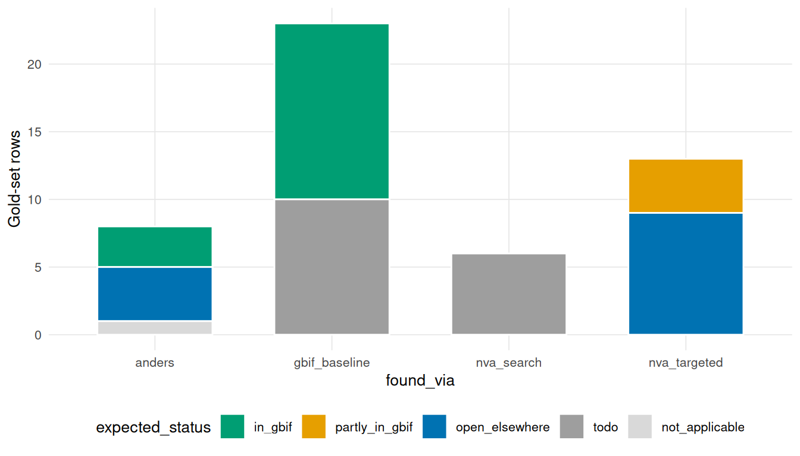
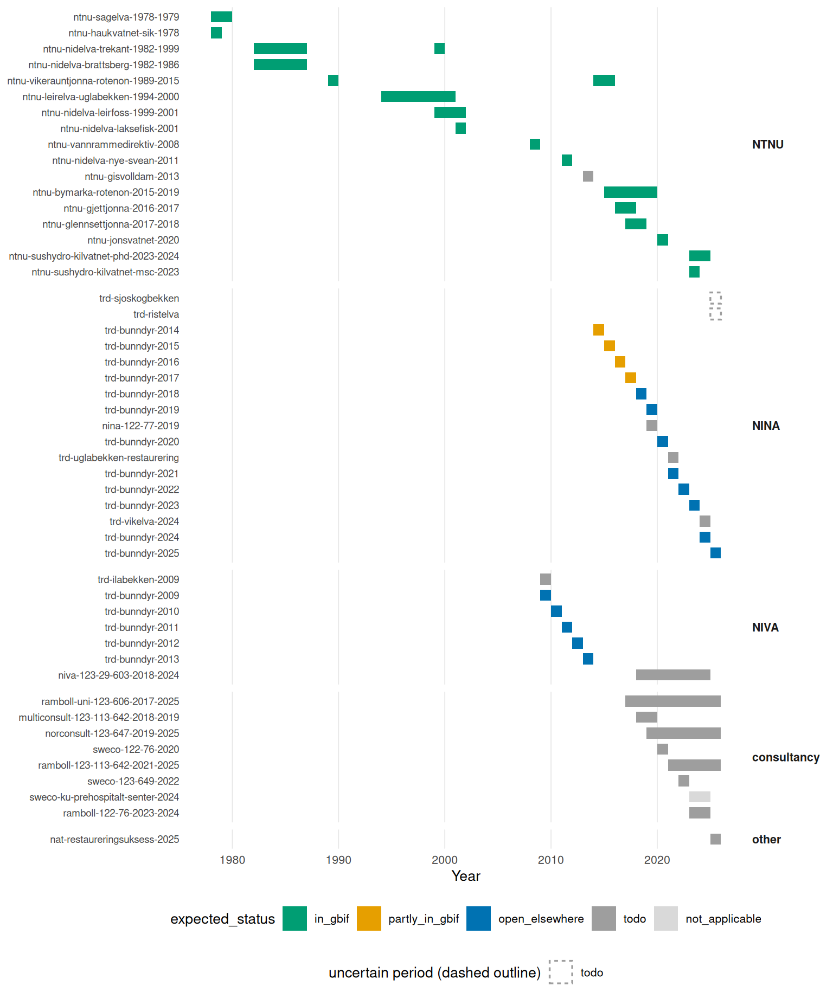
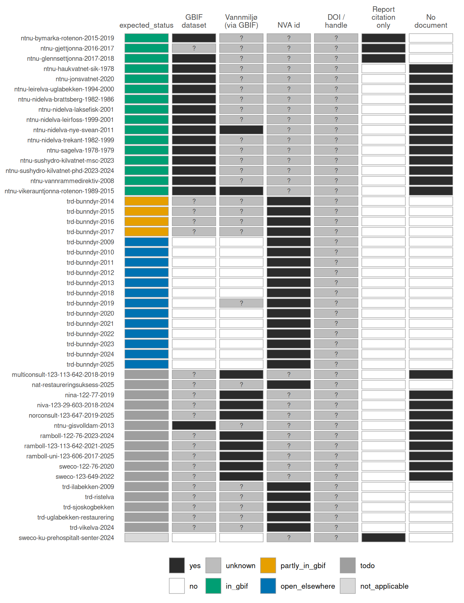
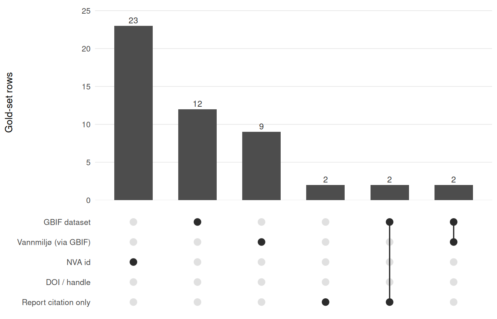
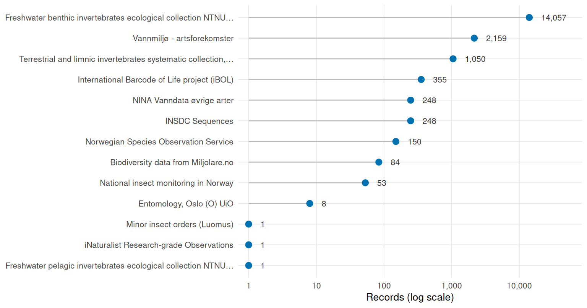
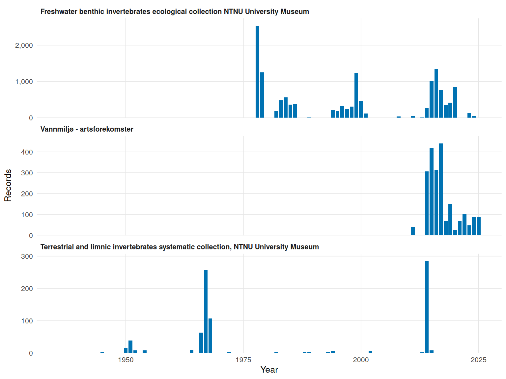

# Gold set and sources: status report

_Generated by `Rscript run.R report`. Do not edit by hand._

| item | value |
| :--- | :--- |
| Inputs as of | 2026-11-18 |
| Input commit | `576e12a` + uncommitted changes |
| Scope | `pilot-ept-trondheim` (EPT, Trondheim kommune) |
| goldset.csv SHA-256 | `22631f4d9af0` |
| Rows (include: yes / candidate / no) | 50 (0 / 48 / 2) |
| Rows with a local full text | 12 (from `goldset/fulltext_manifest.csv`) |

> [!WARNING]
> **Everything in this report is provisional.** No gold-set row has `include = yes`:
> all rows are unverified candidates or exclusions until Anders has checked them.

Contents: [Gold set](#gold-set-at-a-glance) · [Timeline](#timeline) ·
[Sources](#source-comparison) · [GBIF baseline](#gbif-baseline) ·
[Benchmarks](#pipeline-benchmarks) · [Open items](#open-items) · [Figures](#figures)

## Gold set at a glance

Rows by `expected_status` and `found_via` (all `include` values).

| expected_status | anders | gbif_baseline | nva_search | nva_targeted | total |
| :--- | ---: | ---: | ---: | ---: | ---: |
| in_gbif | 3 | 13 | 0 | 0 | 16 |
| partly_in_gbif | 0 | 0 | 0 | 4 | 4 |
| open_elsewhere | 4 | 0 | 0 | 9 | 13 |
| todo | 0 | 10 | 6 | 0 | 16 |
| not_applicable | 1 | 0 | 0 | 0 | 1 |

**Borderline**

| is_borderline | rows |
| :--- | ---: |
| no | 40 |
| yes | 10 |

**Institution type.** Rule (`institution_group()` in `R/report.R`): drop
"(oppdragsgiver …)", then the first match of NTNU, NINA, NIVA, consultancy
(named firms or an AS/AB legal form), otherwise other.

| institution_type | rows |
| :--- | ---: |
| NTNU | 17 |
| NINA | 17 |
| NIVA | 7 |
| consultancy | 8 |
| other | 1 |

## Timeline

One bar per survey over its period (a single year spans that year). Colour is
`expected_status`; panels are institution types. Periods marked `?` are drawn
as dashed outlines.

All periods were parsed.

## Source comparison

Each cell says whether the gold set records evidence that the survey can be
found in that source: `yes` (identifier or exact match), `no` (the gold set
asserts absence), `unknown` (cannot be decided from the recorded fields; never
a guess). Rules, one tested function each in `R/report.R`:

| column | yes | no | unknown |
| :--- | :--- | :--- | :--- |
| GBIF dataset | `where_data_are` cites a non-aggregator datasetKey (full UUID, or an 8-hex prefix matching exactly one dataset in the baseline), or quotes `datasetName "…"` equal to a non-aggregator group in `gbif_survey_groups` | no evidence, and `expected_status` is open_elsewhere, exists_not_available, unidentified or not_applicable | otherwise; also when evidence and such a status conflict (listed under Flags) |
| Vannmiljø (via GBIF) | `where_data_are` cites the Vannmiljø datasetKey (from `knowledge/aggregators/vannmiljo.md`), or a vannlokalitetkode found in a Vannmiljø group in a year inside the parsed period | same as GBIF dataset | same as GBIF dataset |
| NVA id | `documents` contains `nva:<id>` | never | otherwise |
| DOI / handle | `documents` contains a DOI (`10.xxxx/…`) or a handle (`hdl:`, `handle:`, `hdl.handle.net`) | never | otherwise |
| Report citation only | `documents` is non-empty and has no NVA id, DOI or handle (an ISBN is not a repository id) | otherwise | never |
| No document | `documents` is empty | otherwise | never |

### What the matrix says

- 50 gold-set rows; 123 of 250 source cells are `unknown`.
- The source covering most rows is NVA id (23 of 50).
- Rows covered by exactly one source: GBIF dataset (12), Vannmiljø (via GBIF) (9), NVA id (23), Report citation only (2).
- 0 rows have no source marked `yes`.
- 23 rows have no document at all; 4 rows cite a report without a repository id.
- 6 rows are flagged below (status and evidence disagree, or a GBIF status lacks a resolvable datasetKey).

### Coverage per source

| source | rows covered | rows only this source | rows unknown |
| :--- | ---: | ---: | ---: |
| GBIF dataset | 16 | 12 | 20 |
| Vannmiljø (via GBIF) | 11 | 9 | 26 |
| NVA id | 23 | 23 | 27 |
| DOI / handle | 0 | 0 | 50 |
| Report citation only | 4 | 2 | 0 |

| sources with yes | rows |
| :--- | ---: |
| NVA id | 23 |
| GBIF dataset | 12 |
| Vannmiljø (via GBIF) | 9 |
| Report citation only | 2 |
| GBIF dataset + Report citation only | 2 |
| GBIF dataset + Vannmiljø (via GBIF) | 2 |

### Flags

| survey_ref | flag |
| :--- | :--- |
| trd-bunndyr-2014 | status says GBIF; no datasetKey or survey-group match in where_data_are |
| trd-bunndyr-2015 | status says GBIF; no datasetKey or survey-group match in where_data_are |
| trd-bunndyr-2016 | status says GBIF; no datasetKey or survey-group match in where_data_are |
| trd-bunndyr-2017 | status says GBIF; no datasetKey or survey-group match in where_data_are |
| ntnu-gjettjonna-2016-2017 | status says GBIF; no datasetKey or survey-group match in where_data_are |
| trd-bunndyr-2019 | status says not in GBIF, but where_data_are matches GBIF evidence; cell set to unknown |

Dataset-key prefixes in `where_data_are` with no EPT records in the scope baseline, i.e. datasets for other taxon groups. Other groups are outside the pilot, so these are ignored by design:

| survey_ref | key_prefix |
| :--- | :--- |
| ntnu-bymarka-rotenon-2015-2019 | fcb19622 |

Full matrix (table)

| survey_ref | expected_status | include | GBIF dataset | Vannmiljø (via GBIF) | NVA id | DOI / handle | Report citation only | No document |
| :--- | :--- | :--- | :--- | :--- | :--- | :--- | :--- | :--- |
| ntnu-bymarka-rotenon-2015-2019 | in_gbif | candidate | yes | unknown | unknown | unknown | yes | no |
| ntnu-gjettjonna-2016-2017 | in_gbif | no | unknown | unknown | unknown | unknown | yes | no |
| ntnu-glennsettjonna-2017-2018 | in_gbif | candidate | yes | unknown | unknown | unknown | yes | no |
| ntnu-haukvatnet-sik-1978 | in_gbif | candidate | yes | unknown | unknown | unknown | no | yes |
| ntnu-jonsvatnet-2020 | in_gbif | candidate | yes | unknown | unknown | unknown | no | yes |
| ntnu-leirelva-uglabekken-1994-2000 | in_gbif | candidate | yes | unknown | unknown | unknown | no | yes |
| ntnu-nidelva-brattsberg-1982-1986 | in_gbif | candidate | yes | unknown | unknown | unknown | no | yes |
| ntnu-nidelva-laksefisk-2001 | in_gbif | candidate | yes | unknown | unknown | unknown | no | yes |
| ntnu-nidelva-leirfoss-1999-2001 | in_gbif | candidate | yes | unknown | unknown | unknown | no | yes |
| ntnu-nidelva-nye-svean-2011 | in_gbif | candidate | yes | yes | unknown | unknown | no | yes |
| ntnu-nidelva-trekant-1982-1999 | in_gbif | candidate | yes | unknown | unknown | unknown | no | yes |
| ntnu-sagelva-1978-1979 | in_gbif | candidate | yes | unknown | unknown | unknown | no | yes |
| ntnu-sushydro-kilvatnet-msc-2023 | in_gbif | candidate | yes | unknown | unknown | unknown | no | yes |
| ntnu-sushydro-kilvatnet-phd-2023-2024 | in_gbif | candidate | yes | unknown | unknown | unknown | no | yes |
| ntnu-vannrammedirektiv-2008 | in_gbif | candidate | yes | unknown | unknown | unknown | no | yes |
| ntnu-vikerauntjonna-rotenon-1989-2015 | in_gbif | candidate | yes | yes | unknown | unknown | no | yes |
| trd-bunndyr-2014 | partly_in_gbif | candidate | unknown | unknown | yes | unknown | no | no |
| trd-bunndyr-2015 | partly_in_gbif | candidate | unknown | unknown | yes | unknown | no | no |
| trd-bunndyr-2016 | partly_in_gbif | candidate | unknown | unknown | yes | unknown | no | no |
| trd-bunndyr-2017 | partly_in_gbif | candidate | unknown | unknown | yes | unknown | no | no |
| trd-bunndyr-2009 | open_elsewhere | candidate | no | no | yes | unknown | no | no |
| trd-bunndyr-2010 | open_elsewhere | candidate | no | no | yes | unknown | no | no |
| trd-bunndyr-2011 | open_elsewhere | candidate | no | no | yes | unknown | no | no |
| trd-bunndyr-2012 | open_elsewhere | candidate | no | no | yes | unknown | no | no |
| trd-bunndyr-2013 | open_elsewhere | candidate | no | no | yes | unknown | no | no |
| trd-bunndyr-2018 | open_elsewhere | candidate | no | no | yes | unknown | no | no |
| trd-bunndyr-2019 | open_elsewhere | candidate | no | unknown | yes | unknown | no | no |
| trd-bunndyr-2020 | open_elsewhere | candidate | no | no | yes | unknown | no | no |
| trd-bunndyr-2021 | open_elsewhere | candidate | no | no | yes | unknown | no | no |
| trd-bunndyr-2022 | open_elsewhere | candidate | no | no | yes | unknown | no | no |
| trd-bunndyr-2023 | open_elsewhere | candidate | no | no | yes | unknown | no | no |
| trd-bunndyr-2024 | open_elsewhere | candidate | no | no | yes | unknown | no | no |
| trd-bunndyr-2025 | open_elsewhere | candidate | no | no | yes | unknown | no | no |
| multiconsult-123-113-642-2018-2019 | todo | candidate | unknown | yes | unknown | unknown | no | yes |
| nat-restaureringsuksess-2025 | todo | candidate | unknown | unknown | yes | unknown | no | no |
| nina-122-77-2019 | todo | candidate | unknown | yes | unknown | unknown | no | yes |
| niva-123-29-603-2018-2024 | todo | candidate | unknown | yes | unknown | unknown | no | yes |
| norconsult-123-647-2019-2025 | todo | candidate | unknown | yes | unknown | unknown | no | yes |
| ntnu-gisvolldam-2013 | todo | candidate | yes | unknown | unknown | unknown | no | yes |
| ramboll-122-76-2023-2024 | todo | candidate | unknown | yes | unknown | unknown | no | yes |
| ramboll-123-113-642-2021-2025 | todo | candidate | unknown | yes | unknown | unknown | no | yes |
| ramboll-uni-123-606-2017-2025 | todo | candidate | unknown | yes | unknown | unknown | no | yes |
| sweco-122-76-2020 | todo | candidate | unknown | yes | unknown | unknown | no | yes |
| sweco-123-649-2022 | todo | candidate | unknown | yes | unknown | unknown | no | yes |
| trd-ilabekken-2009 | todo | candidate | unknown | unknown | yes | unknown | no | no |
| trd-ristelva | todo | candidate | unknown | unknown | yes | unknown | no | no |
| trd-sjoskogbekken | todo | candidate | unknown | unknown | yes | unknown | no | no |
| trd-uglabekken-restaurering | todo | candidate | unknown | unknown | yes | unknown | no | no |
| trd-vikelva-2024 | todo | candidate | unknown | unknown | yes | unknown | no | no |
| sweco-ku-prehospitalt-senter-2024 | not_applicable | no | no | no | unknown | unknown | yes | no |

## GBIF baseline

Scope records per dataset from gbif run [`2026-11-18_baseline`](../gbif/2026-11-18_baseline/): 13 datasets, 18,415 records.

Year counts are the GBIF year facets logged in `runs/queries.jsonl` (raw
responses in local `data/raw/`), summed over the scope taxa.

| dataset | records (baseline) | records with a year |
| :--- | ---: | ---: |
| Freshwater benthic invertebrates ecological collection NTNU University Museum | 14057 | 14057 |
| Vannmiljø - artsforekomster | 2159 | 2159 |
| Terrestrial and limnic invertebrates systematic collection, NTNU University Museum | 1050 | 845 |

Comparison with the earlier baseline in the same run folder (`comparison.tsv`);
`diff` = now − earlier.

| dataset | n_earlier | n_now | diff | years_earlier | years_now |
| :--- | ---: | ---: | :--- | :--- | :--- |
| Freshwater benthic invertebrates ecological collection NTNU University Museum | 14057 | 14057 | 0 | 1978-2024 | 1978-2024 |
| Vannmiljø - artsforekomster | 2159 | 2159 | 0 | 2011-2025 | 2011-2025 |
| Terrestrial and limnic invertebrates systematic collection, NTNU University Museum | 1050 | 1050 | 0 | 1936-2015 | 1936-2015 |
| International Barcode of Life project (iBOL) | 355 | 355 | 0 | 1993-2015 | 1993-2015 |
| NINA Vanndata øvrige arter | 248 | 248 | 0 | 1905-1988 | 1905-1988 |
| INSDC Sequences | 248 | 248 | 0 | 1997-2014 | 1997-2014 |
| Norwegian Species Observation Service | 150 | 150 | 0 | 1987-2026 | 1987-2026 |
| Biodiversity data from Miljolare.no | 84 | 84 | 0 | 1989-1996 | 1989-1996 |
| National insect monitoring in Norway | 53 | 53 | 0 | 2022-2023 | 2022-2023 |
| Entomology, Oslo (O) UiO | 8 | 8 | 0 | 1932-2023 | 1932-2023 |
| Minor insect orders (Luomus) | 1 | 1 | 0 | 1971-1971 | 1971-1971 |
| iNaturalist Research-grade Observations | 1 | 1 | 0 | 2025-2025 | 2025-2025 |
| Freshwater pelagic invertebrates ecological collection NTNU University Museum | 1 | 1 | 0 | 2019-2019 | 2019-2019 |

## Pipeline benchmarks

**Not run.** There are no search runs in `runs/search/`. Sources active in `config/scope.yaml`: `gbif`; the GBIF baseline is not a literature search and is not benchmarked here.

| source | run | n_eligible | n_found | recall | n_screened | precision |
| :--- | :--- | ---: | ---: | ---: | ---: | ---: |
| gbif | not run |  |  |  |  |  |
| openalex | not run |  |  |  |  |  |
| crossref | not run |  |  |  |  |  |
| datacite | not run |  |  |  |  |  |
| nva | not run |  |  |  |  |  |
| brage_oai_pmh | not run |  |  |  |  |  |
| core | not run |  |  |  |  |  |

How the numbers are computed (`benchmark_recall()` in `R/report.R`, tested in
`tests/testthat/test-report.R`):

- **n_eligible**: gold-set rows with `include = yes`, `expected_status` not
  `not_applicable`, and `found_via` not mapped to the source
  (`gbif_baseline` → gbif, `nva_targeted` → nva, `nva_search` → nva). Recall is never measured on rows the source itself supplied.
- **n_found**: eligible rows matched to a document or dataset the run retrieved.
- **recall** = n_found / n_eligible.
- **n_screened**: records in a hand-checked random sample of the run's output;
  **precision** = relevant records in the sample / n_screened.

Eligible rows per source today, for reference:

| source | include = yes | include = yes or candidate |
| :--- | ---: | ---: |
| gbif | 0 | 25 |
| openalex | 0 | 48 |
| crossref | 0 | 48 |
| datacite | 0 | 48 |
| nva | 0 | 29 |
| brage_oai_pmh | 0 | 48 |
| core | 0 | 48 |

## Open items

Rows with `expected_status = todo` (16) or `is_borderline = yes` (10). Notes are truncated.

| survey_ref | reason | include | notes |
| :--- | :--- | :--- | :--- |
| multiconsult-123-113-642-2018-2019 | todo | candidate | Samme to stasjoner prøvetas senere av Rambøll (egen rad); trolig samme overvåkingsoppdrag med ny konsulent. 1… |
| nat-restaureringsuksess-2025 | todo, borderline | candidate | Nasjonal syntese; avklar om den har egne EPT-data fra Trondheim. Funnet med NVA-søk. |
| nina-122-77-2019 | todo, borderline | candidate | Nevnt i trd-bunndyr-2019 som trolig ikke del av programmet. Kan være en enkeltprøve fra et annet NINA-oppdrag… |
| niva-123-29-603-2018-2024 | todo | candidate | Ikke del av kommunens program (NINA-perioden). Treårig intervall, trolig nasjonal eller regional overvåking. … |
| norconsult-123-647-2019-2025 | todo | candidate | Treårig intervall tyder på et fast overvåkingsprogram. 123-647-R var også stasjon i kommunens program 2014. S… |
| ntnu-gisvolldam-2013 | todo, borderline | candidate | Foreslått som negativt tilfelle (enkeltfunn, ingen undersøkelse): forventet include = no og not_applicable hv… |
| ramboll-122-76-2023-2024 | todo | candidate | Andre datoer enn Rambølls 123-606-R-serie, derfor egen rad. Samme stasjon som Sweco 2020 og kommunens program… |
| ramboll-123-113-642-2021-2025 | todo | candidate | Fortsettelse av Multiconsult-serien 2018–2019 på samme stasjoner. Avklar om én undersøkelse per år (som kommu… |
| ramboll-uni-123-606-2017-2025 | todo | candidate | Uni Research Miljø (nå NORCE LFI) med 2017–2022, Rambøll alene 2021 og 2023–2025. Stasjonen var også med i ko… |
| sweco-122-76-2020 | todo | candidate | Ikke samme oppdrag som sweco-ku-prehospitalt-senter-2024 (den samler ikke inn bunndyr). Status todo: GBIF-sid… |
| sweco-123-649-2022 | todo | candidate | Stasjonen var med i kommunens program 2014–2017. Status todo: GBIF-siden er kjent, men ikke om rapporten har … |
| trd-ilabekken-2009 | todo | candidate | Separat rapport om Ilabekken, trolig oppfølging av gjenåpningen. Funnet med NVA-søk: holdes utenfor recall-må… |
| trd-ristelva | todo | candidate | Konsekvensutredning før tiltak. Funnet med NVA-søk: holdes utenfor recall-målingen for NVA. |
| trd-sjoskogbekken | todo | candidate | Resipientundersøkelse. Funnet med NVA-søk: holdes utenfor recall-målingen for NVA. |
| trd-uglabekken-restaurering | todo, borderline | candidate | Bakgrunn og prinsipper for restaurering; inneholder kanskje ingen nye innsamlinger. Grensetilfelle. Funnet me… |
| trd-vikelva-2024 | todo | candidate | Resipientundersøkelse, ikke del av det årlige programmet. Funnet med NVA-søk: holdes utenfor recall-målingen … |
| ntnu-haukvatnet-sik-1978 | borderline | candidate | Studentoppgave om fiskeernæring; bunndyr som næringsgrunnlag. Grensetilfelle. Status foreløpig. Rapport ikke … |
| ntnu-sagelva-1978-1979 | borderline | candidate | Studentoppgave: grensetilfelle for «profesjonell» (åpent spørsmål i design.md). Status foreløpig. Rapport ikk… |
| ntnu-sushydro-kilvatnet-msc-2023 | borderline | candidate | Masteroppgave; kan slås sammen med ph.d.-raden. Grensetilfelle. Status foreløpig. Rapport ikke identifisert. |
| ntnu-sushydro-kilvatnet-phd-2023-2024 | borderline | candidate | Forskningsprosjekt/ph.d. Grensetilfelle for «profesjonell». Samme stasjon som masteroppgaven (egen rad). Stat… |
| ntnu-vannrammedirektiv-2008 | borderline | candidate | Liten innsamling; Morten Bergan senere ansvarlig for kommunens program (NINA). Avklar om dette er en egen und… |
| sweco-ku-prehospitalt-senter-2024 | borderline | no | Negativt tilfelle: konsekvensutredning som bare sammenstiller eksisterende data for vannmiljø. NiN-kartleggin… |

## Figures

- [`figures/status_by_found_via.png`](figures/status_by_found_via.png)
- [`figures/timeline.png`](figures/timeline.png)
- [`figures/source_matrix.png`](figures/source_matrix.png)
- [`figures/source_overlap.png`](figures/source_overlap.png)
- [`figures/gbif_records_per_dataset.png`](figures/gbif_records_per_dataset.png)
- [`figures/gbif_records_per_year_top3.png`](figures/gbif_records_per_year_top3.png)

